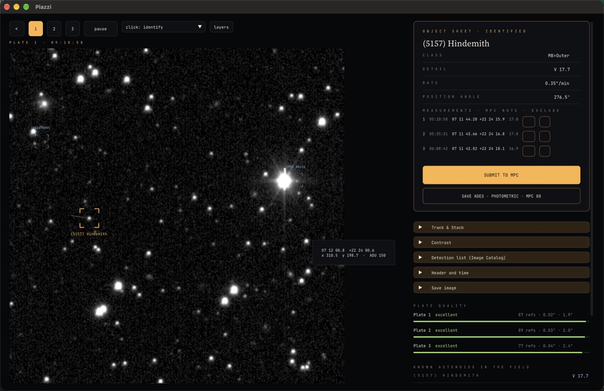

# Piazzi — open source astrometry

<p align="center"></p>

<p align="center">
<a href="https://github.com/datamonkeys-ai/piazzi/actions/workflows/ci.yml"></a>


</p>

**Open source astrometry and photometry of asteroids and comets.** Piazzi finds moving objects in CCD images,
solves the plate against Gaia DR3, measures positions and magnitudes, identifies known bodies and writes ADES/MPC
reports. It runs on macOS, Windows, Linux, iPhone/iPad and in the browser, all on the same C++17 core.

Named after Giuseppe Piazzi, who discovered the first asteroid, Ceres, in 1801.

Piazzi uses its own algorithms, based on published literature (see [`DESIGN.md`](DESIGN.md)), and is checked
against JPL Horizons ephemerides. Settings can be loaded from INI-style `.cfg` configuration files.

Português: [README.pt-BR.md](README.pt-BR.md)

## Features
1. Reads **FITS** and **SBIG ST-x** (compressed or not), computes mid-exposure time, applies dark and flat frames.
2. Detects sources (background + σ threshold, Gaussian PSF fit).
3. Downloads reference catalogs (**Gaia DR3**, UCAC4, CMC-15, PPMXL, ATLAS-RefCat2) from VizieR, with mirrors.
4. **Plate reduction** of order 1–3 with astrometric and photometric outlier rejection; zero point against Gaia.
5. **Moving objects** (≥ 3 images), Track & Stack and manual measurement.
6. **Identification** via IMCCE SkyBoT (online) or `MPCORB.DAT`/`COMET.DAT` (offline).
7. `ADESReport.psv`, `PhotReport.txt` and 80-column `MPCReport.txt`; submission to the MPC with a test mode.

## Download and use
No installation needed beyond the app itself:

| Version | Requirements |
|---|---|
| macOS (`Piazzi-mac.dmg`) | macOS 10.13+ (Intel or Apple Silicon) |
| Windows (`Piazzi-windows-x64.zip`) | Windows 10 1803+ 64-bit, OpenGL 3.0+ · **not yet tested on real Windows hardware** |
| Linux (`.AppImage`) | glibc ≥ 2.35 (Ubuntu 22.04+), libGL/X11 or Wayland, `libfuse2` |
| iPhone / iPad | iOS 17+ (build with Xcode for now) |
| Web | **https://datamonkeys.ai/piazzi/app/** (nothing to install), or locally with `python3 web/serve.py` (Python 3, standard library only) |

> **Windows build: not yet tested.** It is cross-compiled and packaged automatically, but nobody has run it on a
> real Windows PC yet. If you try it, please open an issue with what happened.

Internet is only needed to download the reference catalog and to identify objects; offline work uses local catalog
and `MPCORB.DAT` files. Installers are built with the scripts in `packaging/` (see [Deploy](#deploy)).

## Architecture
```
cpp/src, cpp/include           dependency-free C++17 core (detection, plate, photometry, orbits, reports)
cpp/include/piazzi/astro_c.h   stable C API used by every app
├── cpp/src/main_cli.cpp       `piazzi` command-line tool
├── cpp/gui/                   desktop app (Dear ImGui + SDL2): macOS, Windows, Linux
├── ios/                       SwiftUI app (iPhone, iPad, Mac Catalyst) over the C API
└── web/                       core compiled to WebAssembly + web UI; web/serve.py is a CORS proxy
cpp/tests/                     tests; accuracy against JPL Horizons with a versioned Gaia DR3 catalog (cpp/tests/data)
packaging/                     installer scripts (DMG, AppImage, Windows zip)
```

## Build (development)

### Requirements
- CMake ≥ 3.20, Ninja and a C++17 compiler (core, CLI, desktop)
- SDL2 for the desktop app (`brew install sdl2`, `apt install libsdl2-dev`) or `-DASTRO_FETCH_SDL2=ON`
- Xcode 16+ and [XcodeGen](https://github.com/yonaskolb/XcodeGen) for the iOS app
- Emscripten only to rebuild `web/astro.wasm`

### Setup
```sh
cmake -S cpp -B cpp/build -G Ninja && cmake --build cpp/build
```

## Usage

### Try the example first
Every app (desktop, web, iPhone/iPad) has an **Open example** button on the home screen. It reduces three ZTF
exposures of the asteroid (5157) Hindemith (2021-02-06, 6′ crops, Gaia DR3 stars included) fully offline, so you can
see the whole flow — plate solution, mover detection, ADES/MPC reports — before using your own images. The example uses
observatory code `XXX` and MPC submission is blocked while it is loaded (it is not your observation). Data and credits:
[`cpp/gui/assets/example/README.md`](cpp/gui/assets/example/README.md). From the command line:
```sh
cd cpp/gui/assets/example && ../../../build/piazzi --cfg example.cfg --catalog gaia_dr3.tsv \
  --center "07 11 43.534" "+22 24 17.78" --out /tmp/example ztf_hindemith_*.fits
```

### Desktop app
```sh
./cpp/build/Piazzi.app/Contents/MacOS/Piazzi      # macOS (Linux/Windows: cpp/build/Piazzi)
```
Open your images (or drag them onto the window). Steps run automatically: catalog → plate → motion → identification.
The interface is in English by default; Portuguese can be chosen in Settings. Settings are grouped (camera, detection,
plate, motion, reports, advanced) with a hint on each field and "Restore defaults"; the list comes from the core
(`astro_settings_schema()`), so the three apps show the same parameters.

### CLI
```sh
./cpp/build/piazzi --cfg my.cfg --catalog gaia.tsv --center "07 11 43.534" "+22 24 17.78" --object "5157" --out result img1.fits img2.fits img3.fits
```

### Web
```sh
python3 web/serve.py            # http://localhost:8777  (or: docker compose up)
```

### iPhone / iPad
```sh
cd ios && DEVELOPMENT_TEAM=<your Team ID> xcodegen && open Piazzi.xcodeproj
```

## Environment
Copy [`.env.example`](.env.example) to `.env`. Read by `web/serve.py` and `docker compose`:
`PORT`, `HOST` (`0.0.0.0` exposes the server on your local network), `PROXY_TIMEOUT`, `LOG_LEVEL`.
The desktop app keeps settings and reports in the system preferences folder.

## Test
```sh
ctest --test-dir cpp/build              # C++ core tests
sh cpp/tests/accuracy.sh                # CLI: positions vs JPL Horizons (≤ 0.06"), plates, rate, magnitudes
```
Image-based tests use the bundled example (`cpp/gui/assets/example/`); no download is needed.

### Accuracy against JPL Horizons
- Bundled example ((5157) Hindemith, 3 × 30 s ZTF, 2021-02-06): max residual 0.021″, rms 0.016″; 77–89 Gaia DR3
  reference stars per plate, plate rms 0.02–0.05″; motion 0.353″/min at PA 276.5° (Horizons 0.353″/min, 276.6°).
- ZTF development set (20 sequences): target found in 15/20, |O−C| median 0.059″ / p95 0.307″, 0.05 false tracks per
  sequence; ADES σ calibrated (median |O−C|/σ 0.78 vs 0.83 expected).
- SDSS (held-out, other instrument): 29/32, |O−C| median 0.030″ / p95 0.163″.
- Blind ZTF test set (23 sequences incl. 10 fast NEAs, run only after development was frozen): 16/21, |O−C| median
  0.108″ / p95 0.323″, no false tracks.

Details and history in [`DESIGN.md`](DESIGN.md#accuracy).

## Deploy
Installers are built locally (nothing is published automatically); see [`packaging/README.md`](packaging/README.md):
```sh
IDENTITY="Developer ID Application: Name (TEAMID)" packaging/build_mac.sh   # dist/Piazzi-mac.dmg
packaging/build_windows.sh        # dist/Piazzi-windows-x64.zip
packaging/build_linux.sh amd64    # dist/Piazzi-linux-x86_64.AppImage
docker build -t piazzi .          # CLI + web version in a container
```

## Contributing
See [`CONTRIBUTING.md`](CONTRIBUTING.md), [`CODE_OF_CONDUCT.md`](CODE_OF_CONDUCT.md) and [`SECURITY.md`](SECURITY.md).
Changes: [`CHANGELOG.md`](CHANGELOG.md). License: [MIT](LICENSE); third-party components: [`THIRD_PARTY_NOTICES.md`](THIRD_PARTY_NOTICES.md).
