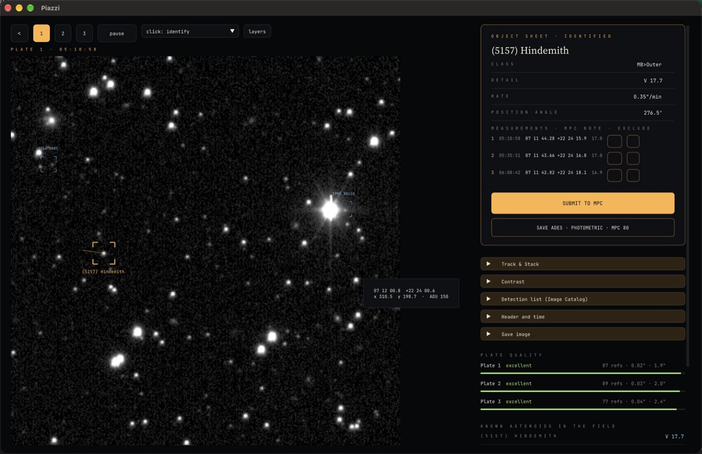

# Piazzi — astrometria open source

<p align="center"></p>

<p align="center">
<a href="https://github.com/datamonkeys-ai/piazzi/actions/workflows/ci.yml"></a>


</p>

**Astrometria e fotometria open source de asteroides e cometas.** O Piazzi encontra objetos em movimento em imagens
CCD, resolve a placa contra o Gaia DR3, mede posições e magnitudes, identifica corpos conhecidos e gera relatórios
ADES/MPC. Roda no macOS, Windows, Linux, iPhone/iPad e no navegador, todos sobre o mesmo núcleo C++17.

O nome homenageia Giuseppe Piazzi, que descobriu o primeiro asteroide, Ceres, em 1801.

O Piazzi usa algoritmos próprios, baseados em literatura publicada (ver [`DESIGN.md`](DESIGN.md)), e é conferido
contra as efemérides do JPL Horizons. As configurações podem ser lidas de arquivos `.cfg` no estilo INI.

English: [README.md](README.md)

## O que faz
1. Lê **FITS** e **SBIG ST-x** (compactado ou não), calcula o meio da exposição, aplica dark e flat.
2. Detecta fontes (fundo por malha + limiar σ, ajuste de PSF gaussiana).
3. Baixa catálogos de referência (**Gaia DR3**, UCAC4, CMC-15, PPMXL, ATLAS-RefCat2) do VizieR, com espelhos.
4. **Redução de placa** de ordem 1–3 com rejeição de resíduos; zero-point contra o Gaia.
5. **Objetos em movimento** (≥ 3 imagens), Track & Stack e medida manual.
6. **Identificação** pelo SkyBoT (online) ou por `MPCORB.DAT`/`COMET.DAT` (offline).
7. `ADESReport.psv`, `PhotReport.txt` e `MPCReport.txt` (80 colunas); envio ao MPC com modo de teste.

## Baixar e usar
| Versão | Requisitos |
|---|---|
| macOS (`Piazzi-mac.dmg`) | macOS 10.13+ (Intel ou Apple Silicon) |
| Windows (`Piazzi-windows-x64.zip`) | Windows 10 1803+ 64 bits, OpenGL 3.0+ · **ainda não testado em um Windows real** |
| Linux (`.AppImage`) | glibc ≥ 2.35 (Ubuntu 22.04+), libGL/X11 ou Wayland, `libfuse2` |
| iPhone / iPad | iOS 17+ (por enquanto, compilando no Xcode) |
| Web | **https://datamonkeys.ai/piazzi/app/** (sem instalar nada), ou localmente com `python3 web/serve.py` (só a biblioteca padrão do Python) |

> **Build do Windows: ainda não testado.** Ele é compilado e empacotado automaticamente, mas ninguém o rodou ainda
> em um PC com Windows. Se você testar, abra uma issue contando o que aconteceu.

Internet só para baixar o catálogo e identificar objetos; offline funciona com catálogo e `MPCORB.DAT` locais.

## Compilar
Requisitos: CMake ≥ 3.20, Ninja e compilador C++17; SDL2 para o desktop (ou `-DASTRO_FETCH_SDL2=ON`);
Xcode 16+ e XcodeGen para o iOS; Emscripten só para recompilar `web/astro.wasm`.
```sh
cmake -S cpp -B cpp/build -G Ninja && cmake --build cpp/build
ctest --test-dir cpp/build              # testes do núcleo
sh cpp/tests/accuracy.sh                # posições comparadas com o JPL Horizons (usa o exemplo incluído)
```

### Uso
```sh
./cpp/build/Piazzi.app/Contents/MacOS/Piazzi      # desktop (Linux/Windows: cpp/build/Piazzi)
./cpp/build/piazzi --cfg meu.cfg --catalog gaia.tsv --center "07 11 43.534" "+22 24 17.78" --object "5157" --out resultado img*.fits
python3 web/serve.py                              # versão web em http://localhost:8777 (ou: docker compose up)
cd ios && DEVELOPMENT_TEAM=<seu Team ID> xcodegen && open Piazzi.xcodeproj
```
Variáveis de ambiente da versão web: ver [`.env.example`](.env.example).

**Comece pelo exemplo:** os três apps têm o botão **Open example** (Abrir exemplo) na tela inicial. Ele reduz, sem
internet, três exposições do ZTF do asteroide (5157) Hindemith (2021-02-06, recortes de 6′, com as estrelas do Gaia
DR3), mostrando o fluxo completo — placa, objeto em movimento, relatórios ADES/MPC. O exemplo usa o código `XXX` e o
envio ao MPC fica bloqueado enquanto ele está carregado (não é uma observação sua). Dados e créditos:
[`cpp/gui/assets/example/README.md`](cpp/gui/assets/example/README.md). A interface vem em inglês; o português é
escolhido nos Ajustes (no iPhone segue o idioma do sistema, com opção de trocar).

### Precisão contra o JPL Horizons
- Exemplo incluído ((5157) Hindemith, 3 × 30 s do ZTF, 2021-02-06): resíduo máximo 0,021″, rms 0,016″; 77–89
  estrelas Gaia DR3 por placa, rms da placa 0,02–0,05″; movimento 0,353″/min em AP 276,5° (Horizons 0,353″/min, 276,6°).
- Conjunto de desenvolvimento ZTF (20 sequências): alvo achado em 15/20, |O−C| mediana 0,059″ / p95 0,307″, 0,05
  trilha falsa por sequência; σ do ADES calibrado (mediana de |O−C|/σ 0,78 para 0,83 esperado).
- SDSS (reservado, outro instrumento): 29/32, |O−C| mediana 0,030″ / p95 0,163″.
- Conjunto cego ZTF (23 sequências, 10 NEAs rápidos, rodado só com o desenvolvimento congelado): 16/21, |O−C| mediana
  0,108″ / p95 0,323″, nenhuma trilha falsa.

Detalhes e histórico em [`DESIGN.md`](DESIGN.md#accuracy).

## Instaladores
Gerados localmente; ver [`packaging/README.md`](packaging/README.md).

## Contribuir
[`CONTRIBUTING.md`](CONTRIBUTING.md), [`CODE_OF_CONDUCT.md`](CODE_OF_CONDUCT.md), [`SECURITY.md`](SECURITY.md),
[`CHANGELOG.md`](CHANGELOG.md). Licença [MIT](LICENSE); componentes de terceiros em
[`THIRD_PARTY_NOTICES.md`](THIRD_PARTY_NOTICES.md).
